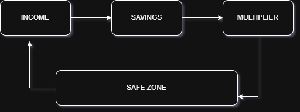
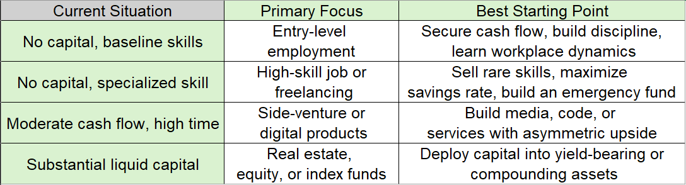

### the simple formla is :

` Wealth = (Income – Expenses) × Return on Investment + Equity Upside`

Foundation -> Accumulation -> Acceleration -> Preservation

### 1- INCOME

- How to Start: Match your resources—if you have no capital, start with a job or freelancing; once you have cash flow, build scalable side projects or invest

- How to Grow: Learn rare, hard-to-replace skills and use leverage (code, content, systems, or capital)

- Types: Active (trading time for money), Leveraged (sales, code, or media decoupled from hours), and Passive (investments earning returns)

- How to Protect: Keep living costs low, avoid dangerous debt, and don't rely on just one client or employer

- Why It’s Hard: Easy skills face massive competition, while high-earning methods require upfront time or money with no immediate reward

