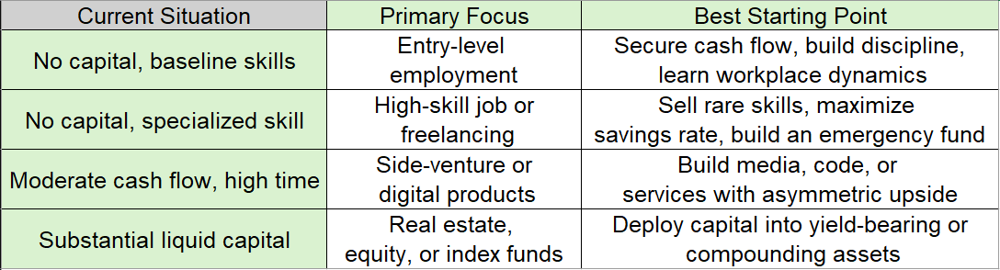

### 1- How to Make Income

- Employment: Sell your skills to an organization with existing infrastructure, distribution, and customers.

- Freelancing / Contracting: Sell specialized skills directly to multiple clients on a project or retainer basis.

- Productized Business: Build a physical or digital product (software, courses, e-commerce, media) and sell it to end-users.

- Capital Allocation: Lend or invest capital into productive assets that pay a yield or appreciate in value.

---

### 2- How to Choose Which One to Start With

##### Rule of thumb: Never start with passive investing if you lack reliable earned income. Use active income to buy the runway and capital needed for leveraged and passive income.

---

### 3- What Types of Income Exist

- Earned (Active) Income: Exchanging time and effort for money (hourly wages, salaries, professional services, consulting)

- Leveraged / Equity Income: Decoupling compensation from direct hours by owning a business, producing products, or earning commissions/royalties

- Asset-Generated (Passive) Income: Returns produced directly by deploying capital (stock dividends, bond interest, rental yields, business distributions)

---

### 4- How to Increase Income

- Increase Rarity (Replaceability): The harder a problem is to solve, the more the market pays. Stack complementary skills (e.g., engineering + negotiation, or data analysis + domain sales)

- Renegotiate or Reposition: Switch companies every 2–3 years to capture market rates, or reposition services from low-budget individual clients to enterprise B2B clients who evaluate value on ROI rather than price

- Apply Leverage: Multiply the reach of your labor:
  - Code & Media: Products with zero marginal cost of reproduction
  - Labor & Systems: Delegating tasks and automating processes
  - Capital: Reinvesting profits back into operations or market capture

### 5- How to Prevent Income from Declining

- Diversify Revenue Sources: Do not rely permanently on a single employer or a single client. Build secondary streams or investment yields once your primary base is stable

- Continuous Reskilling: Track technological shifts (e.g., automation, AI tools) and integrate them into your workflow before they commoditize your role

- Build Direct Audience / Distribution: Owning your distribution (an email list, a professional network, a reputable personal brand) ensures you can sell new offers even if platforms or employers change

- Maintain Low Overhead: When fixed personal expenses stay low, temporary dips in income do not force you into poor, desperate financial decisions

### 6- Why It Is Hard to Make Income

- Extreme Competition in Low-Barrier Fields: If anyone can perform a task with minimal training, the market naturally drives wages down to marginal cost

- The Delayed Gratification Curve: Scalable and passive income models require massive upfront labor or capital accumulation with little to no initial payoff. Most quit before compounding takes effect

- Risk vs. Security Trade-Off: The highest-upside income models carry real risk of failure, while predictable salaries trade upside potential for monthly safety

- Value Disconnect: Beginners often focus on what they want to sell rather than what the market is willing to pay to fix
